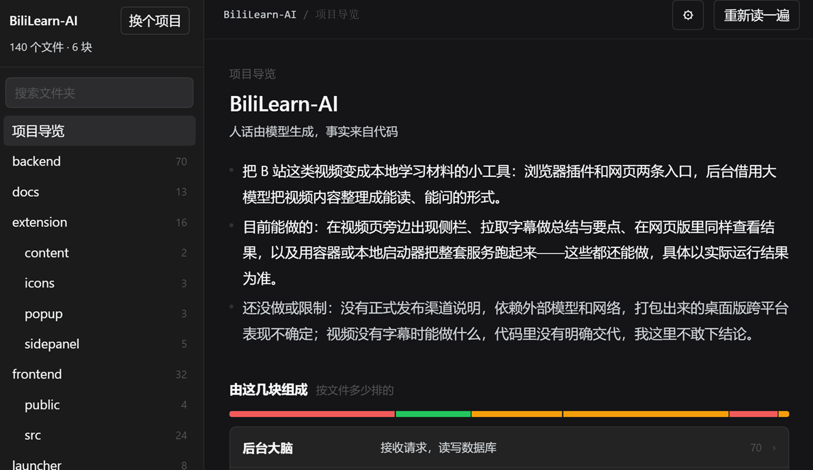
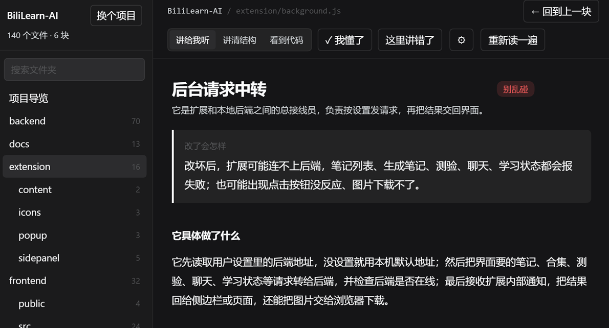

<p align="center"></p>

<p align="center">
  <b>English</b> · <a href="README.md">简体中文</a>
</p>

<p align="center">
  
  
  
</p>

# Three things that happen when you build with an AI coding agent

- **You open a blind box.** The agent says "done"; you have no independent way to check, so you roll again.
- **You can only say "continue".** Not because you don't care, but because describing a problem needs vocabulary — you have "something feels off", it has "the state isn't synced".
- **You finish a project and learn nothing.** The explanation scrolled away with the conversation.

`dsh-project-guide` adds a **tour layer** to your project: folders in plain words, a clear "safe / careful / hands-off" signal, and cards you can come back to.

## What it does

**1. Overview** — what this project is, what it is made of, which three files to read first, and which files you never need to open.

**2. Folder card** — one screen: what this part does, what breaks if you change it, who it is connected to. Each card has three depths: `plain talk` / `structure` / `show the code`.

**3. Down to a file** — the card lists the files inside; open one and it reads only that file: what it does, in what order, what it needs, what it produces, and what breaks when it is wrong.

## Screenshots





Those folder names tell you what they are — `request relay`, `browser add-on`, `the rules of judgment` — instead of `background.js`, `extension`, `core`.

## Install

```bash
git clone https://github.com/yxyusage/dsh-project-guide.git
```

Then install it from that directory in dsh's plugin page (Plugin Manager → Install → pick the folder). A new **Guide** entry appears in the sidebar.

## How it works

Two layers, and facts never mix with opinions:

| Layer | Source | Can it be wrong |
| --- | --- | --- |
| Facts | Read from the filesystem: tree, file counts, who imports whom | No |
| Explanation | A built-in dictionary for common folder names, otherwise your default model | Yes — and it says so |

Deliberate choices:

- **Pay per click.** No whole-repo pre-generation; a file is explained once, on open, then cached by mtime.
- **Send only what matters.** For a file: the header comment, imported modules, declared names and the first 140 lines — not the whole file.
- **Survives a bad model.** Truncated JSON is repaired first (close brackets, drop trailing commas), then retried with a smaller prompt, and finally degrades to structure-only with an explicit note.

## Settings

Gear icon:

- **Let the model explain** — off means seconds instead of a wait, but structure only.
- **How many parts** — 6 / 12 / 18.

Nothing is read at startup; spending is decided by these two switches.

## Limits

- Import graphs cover JS / TS / JSX / Vue / Svelte / Astro relative imports only.
- Two levels deep, 26 nodes max — a map with 200 folders is not a map.
- File explanations are per-file; there is no call-graph yet.
- 400 KB per file; binaries are reported as unreadable.

## Development

```
index.js          host half: scan, imports, model call, three read-only APIs
client.js         browser half: sidebar entry + page (no build step, plain JS)
cordis.patch.yml  bundle declaration
locale/           display name and description
dev/probe.mjs     dev probe: hit the API directly to judge real output
```

Changing `index.js` needs a bundle reinstall; `client.js` only needs a page refresh.

## License

MIT © yxynbglass
