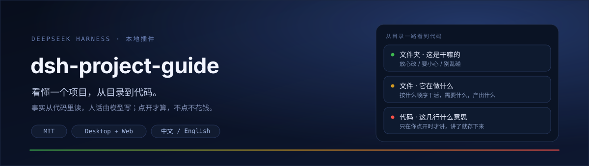

<p align="center"></p>

<p align="center">
  <a href="README.en.md">English</a> · <b>简体中文</b>
</p>

<p align="center">
  
  
  
</p>

# 你在 dsh 里大概遇到过这三件事

- **开盲盒**：AI 说「做完了」，可你没有独立判断的标准，只能再抽一次。
- **只会说「继续」**：不是不想说清楚，而是描述问题需要先有词汇——你只有「哪里怪怪的」，它说的是「state 没同步」。
- **做完一个项目，自己没学到东西**：它讲的那一遍随对话流走了。

`dsh-project-guide` 给项目加一层**看得懂的结构**：左栏是一棵和 IDE 一样的树，点开哪块就讲哪块，想听深入的点「详细」。

## 长什么样

左边是目录树，文件夹可折叠，根目录下的文件也在里面；中间是详情。

```
▾ dsh-project-guide            17
  ▸ dev                         1
  ▸ docs                        4
    client.js
    index.js                    ← 点一下，右边讲它
    package.json
    README.md
```

- **折叠**：每个文件夹行右侧有 ▸/▾，点它只展开/收起，不动内容。
- **排序**：文件夹在前，组内按名称（中文按拼音、数字自然序）。
- **搜索**：输入关键词，全树匹配并平铺显示。
- **分栏**：左右之间的竖线可以拖，双击复位，宽度记在本机。

## 它怎么工作

分成两件事，花钱的只有第二件：

| | 什么时候 | 花不花模型 |
| --- | --- | --- |
| 扫结构 | 打开项目时一次 `readdir` | 不花。只读目录名，不读文件内容 |
| 讲人话 | 点「详细」时 | 花一次。结果按文件修改时间缓存 |

所以**打开项目永远秒开、永远免费**。没点「详细」之前，你看到的人话来自内置词典（60+ 个常见目录名和文件名）加文件事实（行数、导出、引用），这部分不会编。

详情页会同时出现「事实」和「判断」：前者能信，后者是理解。风险分四档：

**放心改 / 要小心 / 别乱碰 / 未评估**

没有正面证据时就是「未评估」——不会拿默认值假装安全。想一次给一整层定级，点右上角「评估全部」：一次模型调用，几秒钟，结果标「预判」。

## 装上

```bash
git clone https://github.com/yxyusage/dsh-project-guide.git
```

然后在 dsh 的插件页里**从这个目录安装**（Plugin Manager → 安装 → 选择文件夹）。装完左侧栏会多一个「导览」。

## 能力边界

- 引用关系只解析 JS / TS / JSX / Vue / Svelte / Astro 的**相对引用**；其它语言只统计文件。
- **「被谁引用」还没做**——反向索引要扫全项目代码文件，和「秒开」冲突；目前只给「它引用了谁」，且只在你点开那个文件夹时才算。
- 单文件 400KB 上限；二进制和图片会直接说读不了。
- 目录树深度上限 8 层、节点 5000 个、单目录最多列 200 个文件；超出会在页面上标出来。
- 隐藏文件（`.env`、`.git` 等）和依赖目录（`node_modules`、`dist` 等）永远不显示，也不会发给模型。
- 打开项目时会后台算一遍本地引用索引（只读代码文件、不调模型，最多 400 个文件 / 1.5 秒），用来判断"被多少处引用"；超出预算时索引不完整，但不会卡住打开。

## 开发

```
index.js          Host 半：扫树、算事实、调模型，四个只读接口
client.js         浏览器半：侧栏树 + 详情页（无构建步骤，纯 JS + createElement）
cordis.patch.yml  bundle 声明
locale/           Plugin Manager 里显示的名字和描述
dev/probe.mjs     开发探针：直接打 API 看树、事实和「详细」的质量
docs/             README 用图
```

接口（`/api/project-guide/`）：`projects` / `tree` / `node` / `detail`。

改完之后怎么生效：

- `client.js`：刷新页面；
- `index.js`：在 Plugin Manager 里把插件关掉再打开即可热重载，不用重启 dsh。

探针用法：

```bash
node dev/probe.mjs /Users/you/你的项目          # 看结构和精简文案
node dev/probe.mjs --detail /Users/you/你的项目 src   # 顺带跑一次「详细」
# 端口变了就加 --port 12345（默认 54622）
```

## 一起做

欢迎开 issue 和 PR。动手之前先看一眼 [CONTRIBUTING.md](CONTRIBUTING.md)，里面的约定很短。

## License

MIT © yxynbglass
